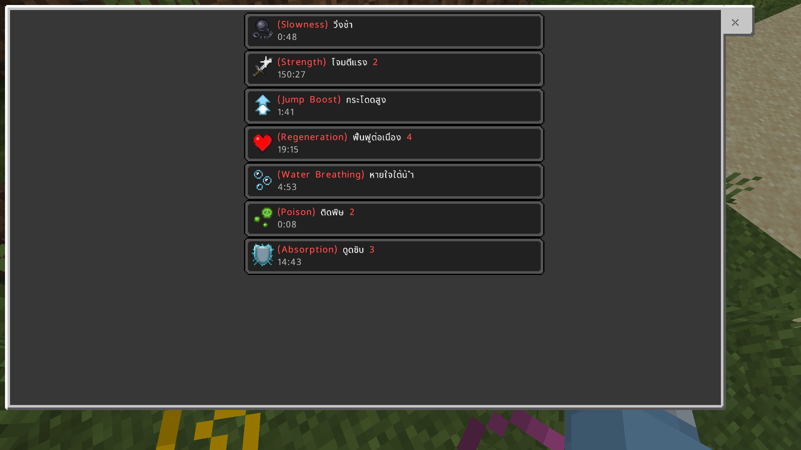
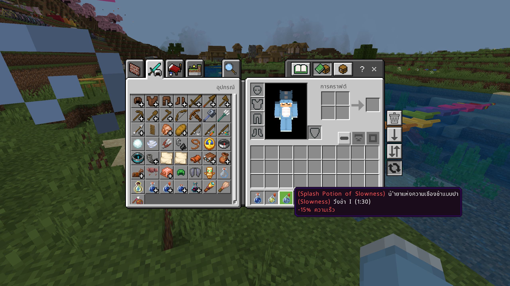

# THLanguage Bedrock Effect Text Fix

[](https://github.com/2RDeX/THLanguage_Bedrock_Effect_Text_Fix/actions/workflows/upstream-sync.yml)
[](https://github.com/2RDeX/THLanguage_Bedrock_Effect_Text_Fix/releases)

**THLanguage Bedrock Effect Text Fix** เป็นรีซอร์ซแพ็กภาษาไทยสำหรับ **Minecraft: Bedrock Edition** ที่พัฒนาต่อยอดจาก [MineGarp/THLanguage_Bedrock](https://github.com/MineGarp/THLanguage_Bedrock) โดยเน้นปรับปรุงคำแปลและข้อความที่เกี่ยวข้องกับ Effect ให้เข้าใจง่ายยิ่งขึ้น

โปรเจกต์นี้ใช้ไฟล์ภาษา `th_TH.lang` เป็นหลัก และมีระบบอัตโนมัติสำหรับตรวจสอบการอัปเดตจากต้นฉบับ นำคำแก้ไขของโปรเจกต์ไปใช้ และสร้างไฟล์ `.mcpack` สำหรับดาวน์โหลด

> โปรเจกต์นี้เป็นงานดัดแปลงโดยชุมชน ไม่ใช่ผลงานอย่างเป็นทางการของ Mojang Studios หรือ Microsoft และไม่มีส่วนเกี่ยวข้องกับทั้งสองบริษัท




## ✨ สิ่งที่ปรับปรุง

- ปรับข้อความภาษาไทยใน `THLanguage_RP/texts/th_TH.lang` ผ่านไฟล์ `mapping.json`
- แก้ไขเฉพาะ Key ที่มีอยู่ในไฟล์ภาษาต้นฉบับเท่านั้น
- ไม่เพิ่ม Key ที่ไม่มีอยู่ในต้นฉบับ โดยระบบจะแจ้งรายการ Key ที่ไม่พบในรายงานการ Build
- คงข้อความและไฟล์ Resource Pack อื่นจากต้นฉบับไว้
- คง UUID ของ Resource Pack และปรับเลข Version ของ Build เมื่อจำเป็น เพื่อให้ Minecraft ตรวจพบแพ็กเวอร์ชันใหม่

## 🤖 Automatic Updates & Builds

โปรเจกต์ใช้ **GitHub Actions** ตรวจสอบ Repository ต้นฉบับ [MineGarp/THLanguage_Bedrock](https://github.com/MineGarp/THLanguage_Bedrock) โดยตั้งรอบตรวจสอบทุก 15 นาที

เมื่อพบการเปลี่ยนแปลงที่เกี่ยวข้อง ระบบจะดำเนินการดังนี้:

1. ตรวจสอบ Commit ล่าสุดของ Repository ต้นฉบับ
2. ดาวน์โหลด Resource Pack จาก Commit นั้น เพื่อให้ไฟล์ทั้งหมดมาจากเวอร์ชันเดียวกัน
3. ใช้ `mapping.json` ปรับเฉพาะ `th_TH.lang`
4. ตรวจสอบไฟล์และโครงสร้าง Resource Pack
5. สร้างและตรวจสอบไฟล์ `.mcpack`
6. เผยแพร่ไฟล์ไปยัง GitHub Actions Artifacts และ GitHub Releases
   
**หมายเหตุเกี่ยวกับเวลา:** รอบ 15 นาทีเป็นกำหนดเวลาที่ตั้งไว้สำหรับ GitHub Actions เท่านั้น GitHub อาจเริ่ม Workflow ล่าช้ากว่าเวลาที่กำหนดในบางช่วง จึงไม่ใช่การรับประกันว่าจะอัปเดตทันทีที่ต้นฉบับเปลี่ยนแปลง

### ดาวน์โหลดไฟล์ที่ Build แล้ว

- **GitHub Releases:** [ดาวน์โหลด](https://github.com/2RDeX/THLanguage_Bedrock_Effect_Text_Fix/releases)


## 📥 วิธีติดตั้ง

1. ดาวน์โหลดไฟล์ `.mcpack` จากหน้า [Releases](https://github.com/2RDeX/THLanguage_Bedrock_Effect_Text_Fix/releases)
2. เปิดไฟล์ `.mcpack` ด้วย Minecraft: Bedrock Edition เพื่อ Import Resource Pack
3. เข้าเกมแล้วเปิด **Settings (ตั้งค่า) → Language (ภาษา)**
4. เลือก **ภาษาไทย (ประเทศไทย)**
5. หากเกมยังแสดงข้อความหรือฟอนต์ไม่ครบ ให้ปิดและเปิด Minecraft ใหม่อีกครั้ง

## 🛠️ การแก้ไขคำแปล

คำแปลที่ต้องการปรับแต่งอยู่ในไฟล์ `mapping.json` ที่ Root ของ Repository โดยใช้รูปแบบ JSON Object ซึ่ง Key ต้องตรงกับ Key ใน `th_TH.lang` และ Value ต้องเป็นข้อความภาษาไทยแบบบรรทัดเดียว

ตัวอย่างรูปแบบ:

```json
{
  "example.translation.key": "ข้อความภาษาไทยที่ต้องการ"
}
```

ข้อควรระวัง:

- แก้ไขเฉพาะ Value ของคำแปลที่ต้องการ ไม่เปลี่ยนชื่อ Key โดยไม่จำเป็น
- หากข้อความต้องมีรหัสสี รูปแบบ หรือ Placeholder ของ Minecraft ให้ใส่ส่วนเหล่านั้นใน Value ให้ถูกต้อง เช่น `§c` หรือ `§r`
- Value ต้องไม่มีการขึ้นบรรทัดใหม่
- Key ที่ไม่มีอยู่ในไฟล์ต้นฉบับจะถูกรายงาน แต่จะไม่ถูกเพิ่มเข้าไปในไฟล์ภาษา
- หลังแก้ `mapping.json` ให้ Commit และ Push ไปยัง Branch `main` ระบบจะตรวจพบการเปลี่ยนแปลงในการตรวจสอบรอบถัดไป

## 📁 โครงสร้างสำคัญ

```text
.
├── .github/
│   └── workflows/
│       └── upstream-sync.yml
├── scripts/
│   ├── update_lang.py
│   ├── prepare_build.py
│   ├── build_mcpack.py
│   └── check_pack.py
├── tests/
├── THLanguage_RP/          # Resource Pack snapshot ใน Repository นี้
├── mapping.json            # คำแปลที่ต้องการปรับแต่ง
├── upstream-state.json     # สถานะ Upstream Build ล่าสุด
├── AUTOMATION.md           # คู่มือระบบ Automation
├── LICENSE
└── README.md
```

Workflow จะดาวน์โหลด Resource Pack ต้นฉบับและทำงานกับสำเนาชั่วคราวในโฟลเดอร์ `.work/` โดยไม่เขียนทับโฟลเดอร์ `THLanguage_RP/` ที่เก็บอยู่ใน Repository นี้ ไฟล์ `.mcpack` ที่เผยแพร่จึงสร้างจาก Resource Pack ต้นฉบับ ณ Commit ที่ Workflow ตรวจพบ พร้อมใช้ Mapping ของโปรเจกต์นี้

## 📚 แหล่งอ้างอิง

- [MineGarp/THLanguage_Bedrock](https://github.com/MineGarp/THLanguage_Bedrock) — Resource Pack ต้นฉบับและการอัปเดตจากผู้พัฒนา
- [Minecraft Wiki ภาษาไทย](https://th.minecraft.wiki/) — แหล่งอ้างอิงคำศัพท์และข้อมูล Minecraft
- [Crowdin – Minecraft Thai](https://crowdin.com/project/minecraft/th) — แหล่งอ้างอิงคำแปลภาษาไทยของ Minecraft: Java Edition

## 🔠 เครดิตฟอนต์และผลงานต้นฉบับ

เครดิตต่อไปนี้อ้างอิงจาก README ของโครงการ MineGarp:

- MinecraftTenTH — **ImNotSus555**
- MinecraftTen — **Mojang Studios**
- Noto Sans Thai — **Monotype และ คัดสรร ดีมาก**

ขอขอบคุณทีม MineGarp และผู้มีส่วนร่วมทุกคนที่สร้างและดูแล Resource Pack ต้นฉบับ ซึ่งเป็นพื้นฐานของโปรเจกต์นี้

## 📄 License & Attribution

โปรเจกต์นี้ดัดแปลงจาก [MineGarp/THLanguage_Bedrock](https://github.com/MineGarp/THLanguage_Bedrock) โปรดอ่านไฟล์ [`LICENSE`](LICENSE) ที่แนบอยู่ใน Repository นี้ และตรวจสอบเงื่อนไขที่เกี่ยวข้องกับไฟล์หรือทรัพยากรจากบุคคลที่สามก่อนนำไปใช้ แจกจ่าย หรือดัดแปลงต่อ

การระบุเครดิตใน README นี้ไม่ได้เปลี่ยนแปลงหรือเพิ่มสิทธิ์เหนือผลงานต้นฉบับและทรัพยากรของบุคคลที่สาม

## 🤝 แจ้งปัญหาและข้อเสนอแนะ

หากพบคำแปลผิดพลาดหรือปัญหาจาก Build สามารถเปิด [Issue](https://github.com/2RDeX/THLanguage_Bedrock_Effect_Text_Fix/issues) ใน Repository นี้ พร้อมระบุเวอร์ชัน Minecraft, เวอร์ชัน Resource Pack และรายละเอียดปัญหาที่พบ
